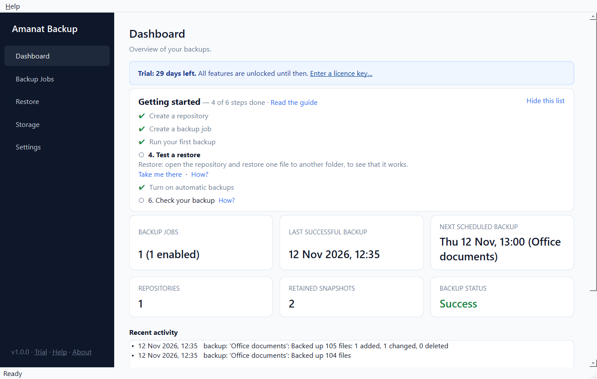
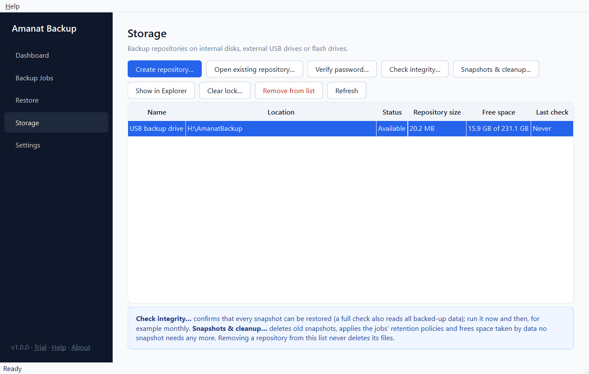
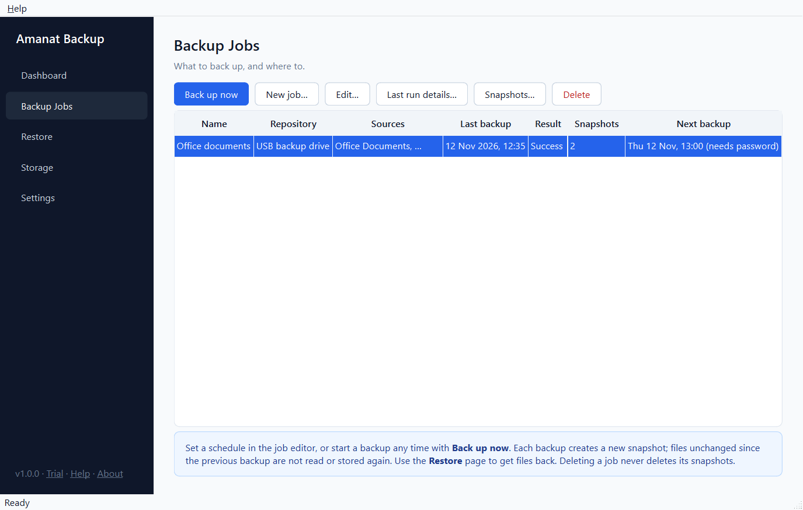
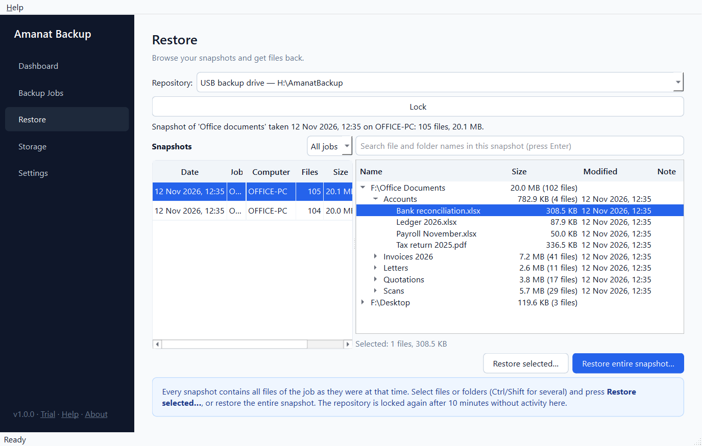

<p align="center">
  
</p>

<h1 align="center">Amanat Backup</h1>

<p align="center"><b>Your files, kept in trust.</b><br>
Offline, encrypted, incremental backup and recovery for Windows, by Mikrotronics Pakistan.</p>

<p align="center">
  <a href="https://github.com/ameriqbalqureshi/amanat-backup-download/releases/latest"><b>⬇ Download the latest version</b></a>
  &nbsp;·&nbsp; Windows 10 / 11 (64-bit) &nbsp;·&nbsp; 30-day free trial
</p>



---

## Contents

- [What it does](#what-it-does)
- [System requirements](#system-requirements)
- [Download and install](#download-and-install)
- [Your first backup in five steps](#your-first-backup-in-five-steps)
- [Automatic backups](#automatic-backups)
- [Restoring files](#restoring-files)
- [Looking after your backups](#looking-after-your-backups)
- [Editions and licence](#editions-and-licence)
- [Updating and uninstalling](#updating-and-uninstalling)
- [Questions and problems](#questions-and-problems)
- [Contact and support](#contact-and-support)

## What it does

Amanat Backup copies your important files to a backup drive, such as a USB drive, a
second disk or a shared folder. It keeps older versions so you can go back to any earlier date.

- **Encrypted.** Everything is encrypted with AES-256 before it reaches the backup drive. If
  the drive is lost or stolen, nobody can see your file names or contents.
- **Fast and small.** After the first backup, only changed files are read. Content that is
  already stored is never stored twice, even if a file is renamed or copied. Files are
  compressed.
- **Version history.** Every backup is a complete snapshot. You can restore one file, a folder
  or everything, exactly as it was on any date.
- **Automatic.** Daily or weekly scheduled backups. A missed backup runs when the computer is
  switched on again, and a backup waiting for its drive runs as soon as the drive is plugged in.
- **Safe against crashes.** A power cut or crash during a backup never damages earlier backups.
- **Checks itself.** Integrity checks confirm your backups can really be restored, and repair
  them when possible.
- **Completely offline.** Your files, and anything else, are never sent over the internet.
- **Built-in help.** Press **F1** anywhere in the program.

## System requirements

- Windows 10 or Windows 11, 64-bit
- About 100 MB of disk space for the program
- A place for the backups: an external USB drive (recommended), a second internal drive or a
  network folder. It should have at least as much free space as the files you back up.

Nothing else is needed. The installer contains everything the program uses.

## Download and install

1. Go to the **[Releases page](https://github.com/ameriqbalqureshi/amanat-backup-download/releases/latest)**
   and download **`AmanatBackup-<version>-Setup.exe`** (under *Assets*).
2. Double-click the downloaded file.
3. **"Windows protected your PC"?** The installer is not yet digitally signed, so Windows
   SmartScreen may show this warning for a new download. Click **More info**, then **Run anyway**.
4. Click **Yes** when Windows asks for permission (the program is installed for all users in
   `C:\Program Files\Amanat Backup`).
5. Follow the wizard: **Next** → choose whether you want a desktop shortcut → **Install** →
   **Finish**. Amanat Backup starts.

You then find **Amanat Backup** in the Start menu.

<details>
<summary><b>Check that the download is genuine (optional)</b></summary>

Each release lists the file's SHA-256 checksum. In PowerShell:

```powershell
Get-FileHash "$env:USERPROFILE\Downloads\AmanatBackup-1.0.0-Setup.exe" -Algorithm SHA256
```

The value shown must match the one on the Releases page exactly.
</details>

<details>
<summary><b>For IT staff: silent and per-user installation</b></summary>

| Command | Effect |
|---|---|
| `AmanatBackup-1.0.0-Setup.exe /VERYSILENT /SUPPRESSMSGBOXES` | silent install for all users |
| `… /VERYSILENT /SUPPRESSMSGBOXES /DIR="D:\Programs\Amanat Backup"` | silent install into another folder |
| `… /CURRENTUSER` | install for the current Windows user only, without administrator rights |
| `"C:\Program Files\Amanat Backup\unins000.exe" /VERYSILENT` | silent uninstall |

Setup refuses to run while Amanat Backup (or one of its scheduled backups) is running. It
never closes the program by force.
</details>

## Your first backup in five steps

When the program starts, the **Dashboard** shows a *Getting started* list that ticks these
steps off as you do them.

### 1. Create a repository

A *repository* is the encrypted storage on your backup drive. Plug in the USB drive, open the
**Storage** page and click **Create repository…**. Choose the drive (or an empty folder on it)
and a strong password. A long phrase, such as four unrelated words and a number, is easy to
remember and hard to guess.



### 2. Save the recovery key

After the repository is created, a **recovery key** is shown **once**. It unlocks your backups
if the password is ever forgotten. Click **Save to file…** or **Copy to clipboard**, or write it
down. Keep it somewhere other than the backup drive, for example printed in a drawer or safe.

> [!WARNING]
> If you lose **both** the password and the recovery key, your backups cannot be opened by
> anyone, including Mikrotronics Pakistan. There is no reset and no back door. This is what keeps
> a stolen backup drive useless to a thief.

### 3. Create a backup job

A *backup job* says what to back up and where to. On the **Backup Jobs** page click
**New job…**, give it a name (for example *Office documents*), choose the repository, and use
**Add folder…** / **Add files…** to add what you want to keep safe. Add exclusions if you like
(for example `.tmp` files).

*What should an office back up?* Documents, Desktop, scanned papers, e-mail data files
(Outlook `.pst`) and the data folder of your accounting or billing software. Programs and
Windows itself do not need backing up.

### 4. Run the first backup

Select the job, click **Back up now**, enter the password and click **Start backup**. The
first backup takes the longest. Later ones only store what changed. When it finishes you see
what was added, changed and deleted.



### 5. Test a restore

Restore one file to another folder (see [Restoring files](#restoring-files)). Now you know
your backup works.

## Automatic backups

1. On **Backup Jobs**, select the job and click **Edit…**.
2. Under **Schedule**, tick **Back up automatically**, choose **Every day** or
   **On these days:** and a time when the computer is usually on (for example lunchtime).
3. Click **Save**. The *Next backup* column shows when it will run.

Useful options in the same place:

- **Run missed backups when the computer is on again**: the backup runs soon after the
  computer is switched on, if it was off at backup time.
- **Run when the backup drive is connected again**: if the USB drive was not plugged in, the
  program checks every 30 minutes for up to 7 days and backs up as soon as it appears.
- **Allow backups without the password (unattended)**: the password is entered once and a key is
  kept on this computer, protected by Windows for your user account. Without this option, a
  scheduled backup shows a notification and waits until you click **Back up now** and enter the
  password.

Scheduled backups run in the background while you are signed in to Windows. A desktop
notification tells you if one fails or needs attention.

## Restoring files



1. Open the **Restore** page, choose the repository, enter the password and click **Open**.
2. On the left, choose the snapshot from the date you want to go back to (newest first).
3. On the right, browse the folders, or type part of a file name in the search box and press
   Enter. Select one or more items (Ctrl or Shift selects several).
4. Click **Restore selected…**, or **Restore entire snapshot…** to restore everything.
5. Choose where to restore to and click **Start restore**:
   - **Another folder** (safest): nothing on your computer is overwritten.
   - **Original location**: files go back exactly where they came from, for example after a
     disk failure or a virus attack.

   If a file already exists you can **Keep both**, **Skip** or **Overwrite** it.

**Restoring is always allowed**, whatever your edition and even after a trial or licence has
ended.

**New computer or reinstalled Windows?** Install Amanat Backup, connect the backup drive, and
on the **Storage** page click **Open existing repository…**. Then restore your files.

## Looking after your backups

- **Check integrity.** On **Storage**, select the repository and click **Check integrity…**.
  A *Quick check* takes seconds to minutes. A *Full check* reads everything and is best done
  monthly. If problems are found, **Repair…** fixes what can be fixed. The next backup with
  **Re-read all files (slower)** ticked stores the damaged files again.
- **Free space.** On **Storage**, **Snapshots & cleanup…** deletes old snapshots. To do this
  automatically, edit the job and under *Which snapshots to keep* choose **Keep only:**. A good
  office default is: last 3, daily 7, weekly 4, monthly 12, yearly 2. Every cleanup shows a
  preview first and changes nothing until you confirm.
- **Good habits:**
  - Keep two backup drives and take one home, swapping them weekly.
  - Unplug the USB drive after the backup, so ransomware can't reach it.
  - Test a restore every few months.
  - Glance at the Dashboard once a week.

## Editions and licence

|                          | Trial          | Pro / Business       | Free edition       |
|--------------------------|----------------|----------------------|--------------------|
| How long                 | first 30 days  | one year, renewable  | no time limit      |
| Backup jobs              | unlimited      | unlimited            | 1                  |
| Data per backup          | unlimited      | unlimited            | 25 GB              |
| Restore, check, clean up | ✔              | ✔                    | ✔ always           |

- **Pro** is for one computer. **Business** licenses several computers (one per computer).
- After the trial, the program continues as the free edition unless a licence is entered.
  Your backups are never locked away.

**To buy or renew:**

1. In the program, open **Help → Licence**.
2. Next to *This computer's code*, click **Copy**.
3. Send the code with your order (see [Contact and support](#contact-and-support)).
4. When you receive your licence key, paste it into the same window, or use
   **Load from file…**, and click **Activate**.

Prices and payment methods are listed in the program under **Help → Contact and payment**.

## Updating and uninstalling

- **Update:** download the new Setup from the
  [Releases page](https://github.com/ameriqbalqureshi/amanat-backup-download/releases) and run it.
  Close Amanat Backup first. Your settings, jobs, history, licence and backups are kept.
- **Uninstall:** Windows **Settings → Apps → Installed apps → Amanat Backup → Uninstall**.
  The program and its scheduled backups are removed. **Your backups and settings are not
  deleted.** Backups stay on your backup drives, and settings stay in
  `%LOCALAPPDATA%\AmanatBackup`. If you install the program again, everything comes back.

## Questions and problems

<details>
<summary><b>I forgot my password.</b></summary>

Wherever a password is asked for, choose **Recovery key** and enter the recovery key instead.
If you have neither, the backups cannot be opened. Create a new repository and back up again.
</details>

<details>
<summary><b>Some files were skipped.</b></summary>

Usually another program had them open, for example Outlook's `.pst` file while Outlook is
running, or an accounting database. Everything else is still backed up, and the file's version
from the previous backup is kept. **Last run details…** on the Backup Jobs page lists the
files. Close the program that uses them and back up again, or schedule backups for a time when
it is closed.
</details>

<details>
<summary><b>A scheduled backup says "Waiting for password".</b></summary>

The job does not allow unattended backups. Click **Back up now** and enter the password, or
edit the job and tick **Allow backups without the password (unattended)**.
</details>

<details>
<summary><b>The backup drive was not found.</b></summary>

Plug it in. The drive letter does not matter, because the program recognises the drive
itself. If the job allows it, the backup runs by itself once the drive is back.
</details>

<details>
<summary><b>Scheduled backups do not run.</b></summary>

They run only while you are signed in to Windows. Check that the job's schedule is ticked and
the *Next backup* column shows a time. In **Settings**, click **Re-create scheduled tasks now**.
</details>

<details>
<summary><b>Does Amanat Backup send my data anywhere?</b></summary>

No. It works completely offline and never connects to the internet.
</details>

More answers are in the program: press **F1** or open **Help**.

## Contact and support

**Mikrotronics Pakistan**

- E-mail: [amanat@mikro.pk](mailto:amanat@mikro.pk)
- Website: [amanat.mikro.pk](https://amanat.mikro.pk)
- Phone, WhatsApp, prices and payment details: in the program under
  **Help → Contact and payment**

When asking for support, open **Help → About**, click **Copy details** and paste them into your
message. This tells us which version you use.

---

<sub>Amanat Backup is proprietary software. Copyright © 2026 Mikrotronics Pakistan. All rights reserved.
This repository only distributes the installer; the source code is not public. The program includes
third-party components (Python, Qt for Python under the GNU LGPL v3, and others); their licences are
in <code>THIRD-PARTY-NOTICES.txt</code> in the program folder.</sub>
